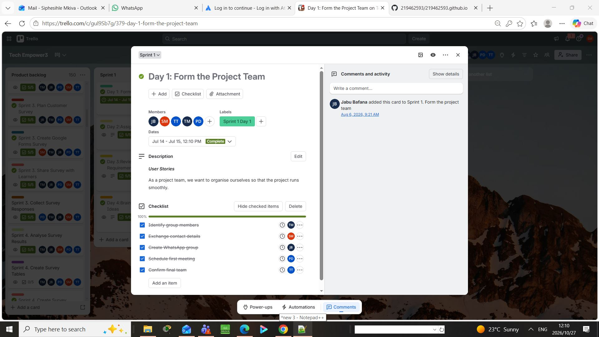

# Siphesihle Mkiva – Curriculum Vitae

This repository contains the curriculum vitae (CV) of **Siphesihle Mkiva**, a motivated ICT student at the Cape Peninsula University of Technology (CPUT) with a strong interest in networking, system support, and communication technologies.

---

## 👤 Personal Details

| Field          | Details                                      |
|----------------|----------------------------------------------|
| Name           | Siphesihle Mkiva                             |
| Phone          | +27 81 064 3604                              |
| Email          | 219462593@mycput.ac.za                       |
| Address        | 8165 Kraai Street, Mfuleni, Extension 6, Cape Town, 7100 |

---

## 🧠 Skills & Strengths

- **Communication** – Clear and effective interpersonal skills  
- **Adaptability** – Quick learner in dynamic environments  
- **Teamwork** – Collaborative and supportive  
- **Critical Thinking** – Analytical problem-solving  
- **Database Management** – MySQL  
- **Web Development** – Frontend using HTML  
- **Operating Systems** – Windows, Linux, macOS (management and troubleshooting)  
- **Network Security** – Basic implementation of firewalls and access controls

---

## 💼 Experience

### MMA YES Learner  
**Shoprite Checkers (Pty) Ltd** – October 2022 – October 2023  

- Provided help desk support for Shoprite Money Market Account customers.  
- Handled queries related to accounts and applications.  
- Promoted the Shoprite Money Market Account to customers.

---

## 🎓 Education

| Year          | Institution / Qualification                     |
|---------------|-------------------------------------------------|
| 2018          | Grade 12 – Mfuleni High School, Cape Town       |
| 2024 – 2026   | Diploma in ICT in Communication Networks – CPUT (currently enrolled) |

---

## 📜 Training & Certifications

| Date       | Certification                                                                 |
|------------|-------------------------------------------------------------------------------|
| 2023-10-03 | YES4Youth Work Readiness Training                                             |
| 2025-05-31 | Basics of Network Layer Protocols – Micro Certificate (Huawei ICT Academy)    |
| 2025-11-12 | Red Hat Training: Getting Started with Linux Fundamentals (RH104 – RHA) Ver. 9.1 |

---

## 📞 References

| Name           | Company               | Contact                     |
|----------------|-----------------------|-----------------------------|
| Wikus De Bruin | Shoprite Checkers (Pty) Ltd | ldebruin@shoprite.co.za |

---
# Reflection

#### What I Did
- Created my first repo and pushed code
- Learned basic git commands: `add`, `commit`, `push`
- Wrote my first `README.md` with Markdown

#### What Went Well
- Markdown syntax for headers and lists was intuitive
- GitHub preview helped me see formatting live
- Linking to other files with `[text](link.md)` worked first try

#### What Was Confusing
- Difference between `git commit` and `git push` at first
- Remembering to close code blocks with triple backticks ```
- Branch vs main workflow
    

---

# Mock Interview Video
<video src="https://raw.githubusercontent.com/219462593/219462593.github.io/main/untitled_v1%20(240p).mp4" width="500" height="500" controls></video>

---
## Mock Interview Reflection

**What I did**: Recorded a 2-3min mock interview  
**How it felt**: Nervous at first, voice shaky, avoided eye contact with camera  
**What went okay**: Answered the main question without freezing, got through it  
**What to improve**: Speak slower, prep 3 bullet points, practice smiling once  
**Takeaway**: It’s uncomfortable, but it gets easier each rep. Shy ≠ unprepared.

---
## 📬 Contact

For opportunities, collaborations, or inquiries, please reach out via email or phone.


*Last updated: March 2026*

---
# Agile Team Charter
---
## Evidence
---

[TechEMPOWER_3B_TeamCharter.1.pdf](https://github.com/user-attachments/files/33983937/TechEMPOWER_3B_TeamCharter.1.pdf)

---
## Reflection

Co-creation. We built the charter iteratively, not in one workshop. First, each member wrote expectations and non-negotiables on a shared whiteboard — silent brainstorming so louder voices did not dominate. Then we grouped ideas into themes and refined them into agreement statements. This process made the charter feel owned by everyone, not dictated by a single person.

Why these agreements. Core hours (12:00–14:00 weekdays) were the only overlap across all five schedules; we limited them to synchronous work so asynchronous tasks stayed flexible. Our Definition of Done was also made concrete, because vague standards usually create conflict later when people assume different levels of completeness.

Living document. In Week 20, a member missed two stand-ups and a deliverable without flagging it, violating the 48-hour rule. Instead of enforcing punishment, we held a retrospective conversation and revised the communication clause so that missed updates had to be acknowledged earlier. That showed the charter was not a policy document but a tool for team learning.

Impact. Before our Sprint 2 demo, a key feature was not working. Because our decision-making protocol was pre-agreed, we called a 15-minute meeting and decided within 10 minutes to drop the feature and prioritize a working demo. The result was a successful presentation and clearer trust in the process.

What I learned is that a charter only works when it is treated as a living artefact — the moment we stopped defending the original document and started improving it was when it actually reduced confusion and improved delivery.

---
# User Stories and Tasks
---
## Evidence
---
### Sprint Goal
Validate the digital divide problem in Cape Town schools and design the core wireframes for the mobile lab booking request feature.

### Selected Product Backlog Items (Committed/Forecasted):

- US-01: As a school principal, I want to submit a request for a mobile computer lab so that my learners can receive digital skills training.
- US-02: As a project manager (internal), I need to review the submitted school requests to allocate lab resources effectively.
- US-03 (Spike/Research): As a development team, we need to gather survey data from Grade 8-12 learners and teachers to validate the need and prioritize features.

### Task Breakdown & Status Table (Planned vs. Completed):

| Sprint # | Sprint Goal | Committed Items | Task Breakdown (Referencing Trello) | Status |
|---------|-------------|----------------|-------------------------------------|--------|
| Sprint 1 | Validate problem & design booking wireframes | US-03 (Research) | • Create project team & WhatsApp group (Trello Day 1)  • Design survey & collect 23 responses  • Analyse data (findings: 70% feel unprepared) | Done |
|  |  | US-01 (Principal Request) | • Draft wireframe for "Request Lab" form  • Define required fields (School name, Grade, Learner count) | Done |
|  |  | US-02 (Admin Review) | • Draft UI for internal admin dashboard to view requests  • Map out data flow from form to dashboard | In Progress (Carried over to Sprint 2) |

### Kanban Board Snapshot (Simulated based on Trello):

- To Do: Draft Admin Dashboard UI (US-02).
- In Progress: Reviewing survey analytics to prioritize features for the booking form.
- Done: Form team (Trello Day 1), Survey creation, Data collection (23 responses), Principal Request Form Wireframe (US-01).

---
## Reflection

#### Commitment vs. Forecast
During Sprint 1, we treated our backlog as a forecast rather than a rigid commitment. We knew that research (US-03) was the priority, but we also forecasted building the UI for both the school request form (US-01) and the admin dashboard (US-02). Because gathering and analyzing the survey data took longer than expected (our 23 responses yielded complex insights), we fell behind on US-02. We handled this gap by accepting reality: instead of rushing a poor design, we moved US-02 to Sprint 2.

#### Sprint Goal Alignment
Our Sprint Goal was strictly about validating the problem and designing the booking request. However, early in the sprint, we included a task to "Create WhatsApp group" and "Exchange contact details" (as seen on our Trello Day 1 card). While this didn't directly serve the product goal, it was essential for the project goal of forming the team. The consequence was minor friction: we lost a few hours of development time to administrative setup, but it was a necessary trade-off for team alignment.

#### Real-time Updates
We kept the board current through daily stand-ups on WhatsApp, but we learned a hard lesson about the cost of not updating Trello in real-time. Mid-sprint, a team member spent hours drafting a survey, not realizing another member had already drafted one—because the Trello card hadn't been moved to "In Progress." This duplication cost us half a day. From that point on, our rule became: update Trello before you start working, not after you finish.

#### Scope Negotiation and Ownership
Midway through the sprint, we realized we could not finish the full admin dashboard (US-02) because the survey data revealed that learners also needed access to the schedule. The team made a democratic decision during a stand-up to descope the admin dashboard to a simple data table and pivot our remaining time to an "US-04: Student Schedule View.". Because this sprint backlog was owned by the developers (us) rather than assigned by a manager, we felt empowered to negotiate the scope. When the manager assigns tasks, developers often hide delays out of fear. Because we owned the backlog, we were transparent about our delays with US-02 and pivoted quickly. This ownership increased our motivation and made our velocity estimates for Sprint 2 much more accurate.

---

# Product Backlog
---
## Evidence
---

[TechEMPOWER 3B Product Backlog](https://trello.com/b/NqVLW18P/tech-empower3?classId=fa272cdc-3e30-4326-b1ee-5f78febe8123&assignmentId=7e04829b-140f-45ab-a5f0-4f49f507f0b7&submissionId=3add15f4-d)

---
## Reflection

Creating and maintaining the product backlog helped our team turn broad ideas into clear, prioritised work. Instead of focusing only on tasks, we started by identifying user needs, features, and constraints, which made it easier to assess trade-offs and keep our delivery focused.

This process taught me that a backlog is more than a list of tasks — it is a communication tool. It helped us align on what mattered most, reduce confusion, and make better trade-off decisions while still leaving room for iteration.

---
## Sprint Backlog

### Evidence



### Patterns Across Entries (Systemic Blockers)

Our recurring blockers were rarely technical; they were about communication fragmentation. The "Day 1" card proves we prioritized setting up a WhatsApp group, but this became a systemic issue. We relied on chat for urgent updates, causing critical decisions to get buried and asynchronous visibility to drop. We lacked a "single source of truth."

The Retrospective-to-Action Loop
In our Sprint 1 retro, we identified constant "what is the status of X?" messages as our biggest friction point. The action item was to move all task updates to Trello before discussing them elsewhere. Tracing this to Sprint 2, we implemented strict tagging in Trello comments (visible in the members assigned to the Day 1 checklist). The result was immediate: stand-ups became shorter because everyone reviewed the board beforehand. This proved to me that retros only work if actions are visibly enforced in the next sprint.

Honesty and Psychological Safety
Early logbook entries were overly polite and glossed over our confusion with the project requirements. However, our culture evolved. When a member eventually candidly admitted they were lost and felt they were slowing us down, the team didn't blame them. Instead, we realized our Definition of Done was too vague and created a shared checklist. This showed we built psychological safety: it became safe to admit a lack of understanding as long as we responded with process fixes.

The Logbook as a Time Capsule
If onboarding a new member tomorrow, I’d use this Trello board as a warning manual. I’d show them the Day 1 card—specifically the tasks to "Exchange contact details" and the user story to "organise ourselves"—and explain: we learned early that assuming communication happens naturally is a mistake. The logbook captures the protocols (like strict Trello usage) required to survive the project, not just the final output.

---

# Agile Logbook

---

## Evidence

---

[PRP37XS Agile Logbook Template - 07-05-26-1.docx](https://github.com/user-attachments/files/33986793/PRP37XS.Agile.Logbook.Template.-.07-05-26-1.docx)

---

## Reflection

My logbook shows that the team moved from planning and slide preparation to delivering the SafeStreet presentation, but the same blockers appeared repeatedly: time pressure, difficulty coordinating tasks, and uneven participation. These patterns taught me that agile work is not just about planning — it is about making uncertainty visible and responsive.

This visible pattern made the value of agile practice clearer. The team was not failing because ideas were bad; we were failing because we did not consistently create enough space for feedback, reflection, and adjustment. Once we clarified responsibilities and increased visibility, work became more focused and less stressful.

What stood out to me was that the team improved when we made the work more visible. Stand-ups, shared check-ins, and clearer responsibilities helped reduce confusion. Even small habits like confirming progress before meetings improved momentum.

Overall, the logbook shows that I learnt to recognise the difference between activity and progress. Doing more tasks is not the same as creating value. Stronger team alignment, better prioritisation, and honest communication created more meaningful output than simply working harder.

